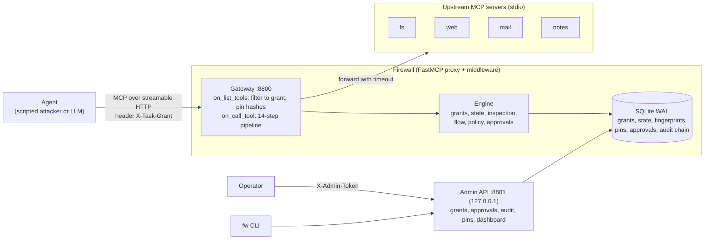

# Architecture

## Request pipeline (every `tools/call`)

1. Resolve grant (NO_GRANT, GRANT_EXPIRED, GRANT_REVOKED, GRANT_EXHAUSTED, TOO_MANY_SESSIONS)
2. Grant state (GRANT_SUSPENDED)
3. Surface check (UNKNOWN_TOOL, RESOURCES_DISABLED, UPSTREAM_REQUEST_BLOCKED)
4. Pin state (TOOL_PINNED_CHANGED, TOOL_POISONED)
5. Grant scope (TOOL_NOT_GRANTED)
6. Rate and loop limits (RATE_LIMIT, LOOP_DETECTED)
7. Size limits (ARG_TOO_LARGE)
8. Argument inspection: secrets and PII, paths and commands, destinations
9. Flow check (EXFIL_FLOW, hard deny) and trifecta rule (approval)
10. Policy rules (deny or approval, never allow)
11. Approval flow (block or defer); hard denies never reach it
12. Reserve one unit of call budget (atomic)
13. Forward to the upstream
14. Result handling: size cap, binary check, injection scan and quarantine, labels and fingerprints, redaction, audit

A deny at any step returns immediately and is audited. In monitor mode every deny is recorded as `would_deny` and the call is forwarded.

## Where state lives

All enforcement state is keyed by grant and stored in SQLite (`firewall/store.py` is the only module that writes SQL): labels, fingerprints, the egress buffer, rate and loop history, the suspended flag. A new session cannot reset any of it.

## Two processes

The gateway (`python -m firewall.server`) and the admin API (`python -m firewall.admin_api`) share one database file. Audit rows are chained under `BEGIN IMMEDIATE`, so both can write without forking the chain.
